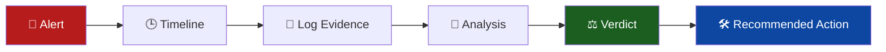

<!-- ═════════════════════════ HEADER ═════════════════════════ -->
<div align="center">


<a href="https://github.com/adiiitya01">
  
</a>

<br/>

<a href="https://linkedin.com/in/aditya-udugade-28147b345"></a>
<a href="mailto:udugadeaditya350@gmail.com"></a>
<a href="https://github.com/adiiitya01/soc-l1-project"></a>


</div>

---

## 🧭 Who I Am

> **I document my security work the way a real analyst would — from raw log to verdict.**

I'm a cybersecurity professional focused on **SOC monitoring & incident triage**, **web application security**, and **VAPT**. I build practical detection and automation tools, and every project here is reproducible, mapped to **MITRE ATT&CK**, and written up like a real incident report.

<table>
<tr>
<td width="50%" valign="top">

### 🎯 Open to roles
- 🔎 **SOC Analyst (L1)**
- 🛡️ **Cybersecurity / Security Analyst**
- 🎯 **VAPT / Penetration Testing Specialist**

</td>
<td width="50%" valign="top">

### ⚡ What I bring
- Structured alert triage & clear incident reporting
- Hands-on SIEM detection with Splunk SPL
- OWASP Top 10 testing mindset
- Python automation for repetitive security work

</td>
</tr>
</table>

---

## 🔄 My Analyst Workflow



Every investigation in my SOC lab follows this exact format, so reports are consistent, auditable, and easy for a team to act on.

---

## 🧰 Tech Arsenal

<div align="center">


</div>

| Domain | What I do |
|:--|:--|
| 🔎 **SOC Operations** | Log analysis · alert triage · detection engineering · incident reporting · MITRE ATT&CK mapping |
| 🌐 **Web App Security** | OWASP Top 10 · XSS · SQL Injection · CSRF · Insecure Deserialization |
| 🎯 **VAPT** | Recon · exploitation · post-exploitation analysis · risk assessment |
| 📡 **Network Security** | Packet analysis · enumeration · protocol analysis |
| 🤖 **Automation** | Python tooling for scanning, reporting and detection workflows |

**SIEM / Detection:** `Splunk` `Sysmon` `Atomic Red Team` &nbsp;|&nbsp; **Pentesting:** `Burp Suite` `Metasploit` `Nmap` `Wireshark` &nbsp;|&nbsp; **Environment:** `Kali Linux` `Windows/Linux hardening` `VirtualBox`

---

## 🚀 Featured Projects

### 🥇 Home SOC Lab — Detection & Triage
[](https://github.com/adiiitya01/soc-l1-project)


A self-built lab that simulates a real SOC: **Splunk** as SIEM, **Sysmon** for endpoint telemetry, and **Atomic Red Team** for safe attack simulation.

```text
Attack Simulation ──► Sysmon Telemetry ──► Splunk Ingestion ──► SPL Detection ──► Incident Report
 (Atomic Red Team)     (endpoint logs)       (SIEM)            (ATT&CK-mapped)   (analyst-style)
```

- ✅ Custom **Splunk SPL detections** mapped to MITRE ATT&CK techniques
- ✅ Full **incident reports**: Alert → Timeline → Log Evidence → Analysis → Verdict → Action
- ✅ **Reproducible setup guides** for Splunk, Sysmon and attack simulation

---

### 🥈 SecureScan Pro — Web Vulnerability Scanner


A Flask-based scanner that identifies common web vulnerabilities and generates structured reports — cutting manual recon time for early-stage assessments.

- ✅ **XSS & SQL injection** detection (pattern- and behavior-based)
- ✅ **Security header & cookie** configuration validation
- ✅ **HTML report generation** with an interactive scan dashboard

---

<table>
<tr>
<td width="50%" valign="top">

### 🥉 Network Packet Sniffer


Real-time passive capture and analysis of live network traffic, built with Python and Scapy — useful for recon and understanding network behavior during assessments.

</td>
<td width="50%" valign="top">

### ⚡ Multi-threaded Port Scanner


Fast service-discovery tool with **banner grabbing** and structured output, designed for accurate recon during pentest engagements.

</td>
</tr>
</table>

---

## 🗺️ Skills Map: Where I Fit on a Security Team

| Team Function | My Contribution |
|:--|:--|
| 🔵 **Blue Team / SOC** | Triage alerts, write ATT&CK-mapped detections, document incidents clearly |
| 🔴 **Red Team / VAPT** | Recon, web app testing, exploitation and risk-rated reporting |
| 🟣 **Security Engineering** | Python tooling and automation that makes teams faster and more consistent |

---

## 📊 GitHub Analytics

<div align="center">


</div>

---

## 📚 Currently Leveling Up

```yaml
focus_areas:
  - SOC detection engineering & threat hunting
  - OWASP Testing Guide v4.2 methodology
  - Security automation with Python
  - Cloud security fundamentals (AWS / Azure)

training:
  - OWASP Top 10 Web Security
  - Network Security Fundamentals
  - Python for Security Professionals
```

---

## 🎯 Mission

I'm working to become a reliable cybersecurity professional who can:

- 🔎 **Detect and triage** incidents with sound analytical reasoning
- 🛡️ **Identify and assess** real-world vulnerabilities in web apps and networks
- 🤖 **Build automation** that makes security teams faster and more consistent
- 📈 **Contribute measurably** to an organization's security posture

---

## 🤝 Let's Connect

<div align="center">

**Hiring for a SOC, security analyst or VAPT role? I'd love to talk.**

<a href="https://linkedin.com/in/aditya-udugade-28147b345"></a>
<a href="mailto:udugadeaditya350@gmail.com"></a>

<br/><br/>

*"Let's build a more secure web."* 🚀


</div>
